<div align="center">

<sub>FH1M / FIELD R-01 / A WORKBENCH WITH A HOME ADDRESS</sub>

<h1>Digital Den</h1>

<p>Arete goes out. Homie holds the fort. The robot still needs debugging.</p>

<picture><source media="(prefers-reduced-motion: reduce)" srcset="docs/assets/digital-den/den-layout.png">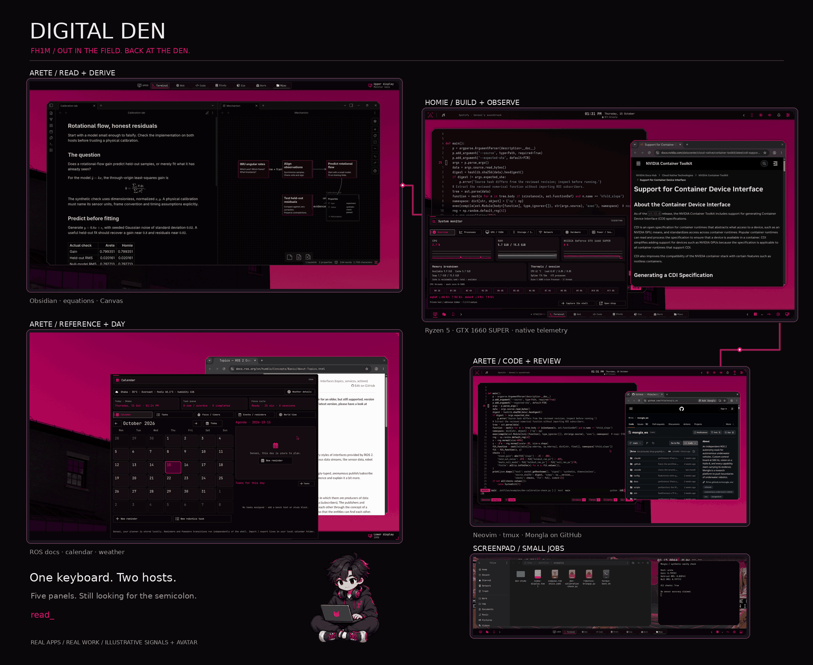</picture>

<sub>TWO HOSTS · FIVE PANELS · ONE KEYBOARD · <a href="docs/assets/digital-den/den-layout.png">FULL-SIZE STILL</a></sub>

[](docs/installation.md) [](home/.config/quickshell/sensei) [](docs/hardware-and-boot.md) [](docs/gpu-and-chrome.md) [](docs/robotics.md) [](LICENSE)

[Gallery](docs/gallery.md) · [Install](docs/installation.md) · [Digital Den](docs/digital-den/README.md) · [Keybinds](docs/keybindings.md) · [Robotics](docs/robotics.md) · [Development](docs/development.md) · [Recovery](docs/operations.md)

</div>

## Welcome to my slightly overqualified desk

I'm **fh1m**. I build underwater robots and work through the software, sensors, electronics and mathematics that make them move. This is the daily driver behind that work: CachyOS, Hyprland, a custom Quickshell desktop, Neovim, persistent tmux sessions, and a lot of hot pink.

**Arete** is the laptop that comes along. **Homie** is the home PC with the storage and a dedicated display GPU. Docked, they become one place to read, derive, code, test, and occasionally remember to eat.

The little hoodie engineer is an illustrated stand-in. The desktops are real.

## 01 / Open the code. Keep the context.

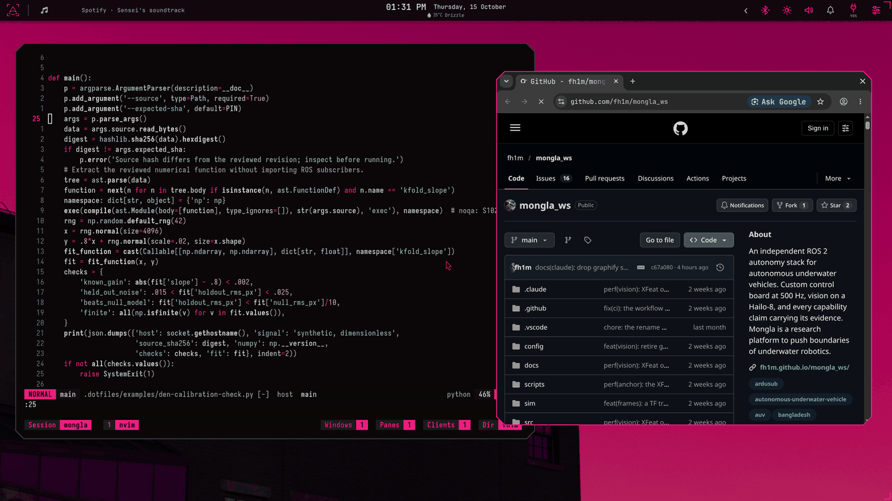

<sub>MAIN // NEOVIM + TMUX + GITHUB · [Native-size image](docs/assets/digital-den/arete-main.png) · [Terminal guide](docs/terminal.md)</sub>

[Mongla](https://github.com/fh1m/mongla_ws) is my ROS 2 underwater-autonomy stack. Here, the editor holds a real numerical check against its optical-flow calibration code; the browser keeps the repository within reach. Room for both. Room for the wallpaper too.

Alacritty stays light. Tmux keeps the session alive. Neovim handles the source, navigation, diagnostics and review. Agents can share the workbench; independent reasoning still gets a seat.

## 02 / Turn “I think” into something testable

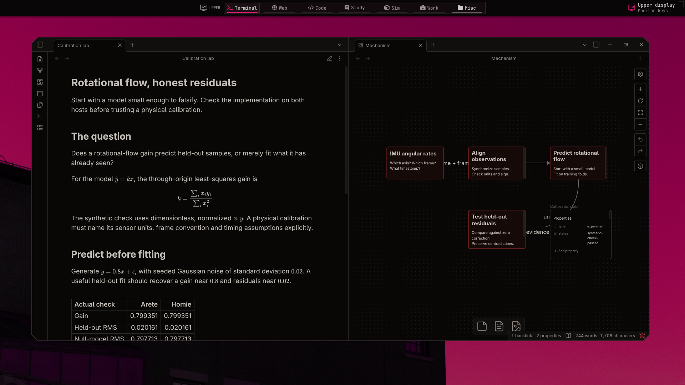

<sub>UPPER // OBSIDIAN + MATHJAX + CANVAS · [Open full size](docs/assets/digital-den/arete-upper.png) · [Public study example](examples/den-study/Calibration%20lab.md)</sub>

A small model, a prediction, a held-out test. The note and Canvas connect angular rates, alignment, rotational flow and residuals. Code belongs in the repository; the reasoning can breathe beside it.

This example actually ran on **both** hosts, using the hash-pinned numerical function from [Mongla's calibration source](https://github.com/fh1m/mongla_ws/blob/c67a0805206b88a25e541a5fe0c3a95afb168b40/tools/flow_derot_calibrate.py).

| Synthetic check | Arete | Homie |
|---|---:|---:|
| Recovered gain, expected 0.8 | 0.799351 | 0.799351 |
| Held-out RMS, noise σ = 0.02 | 0.020161 | 0.020161 |
| Null-model RMS | 0.797713 | 0.797713 |
| Numerical checks | 4 / 4 | 4 / 4 |

<sub>Seeded, dimensionless test data. A reproducible sanity check, not a claim about sensor accuracy. [Run it yourself](docs/digital-den/GALLERY.md#reproduce-the-numerical-check).</sub>

## 03 / Meanwhile, on the other screen

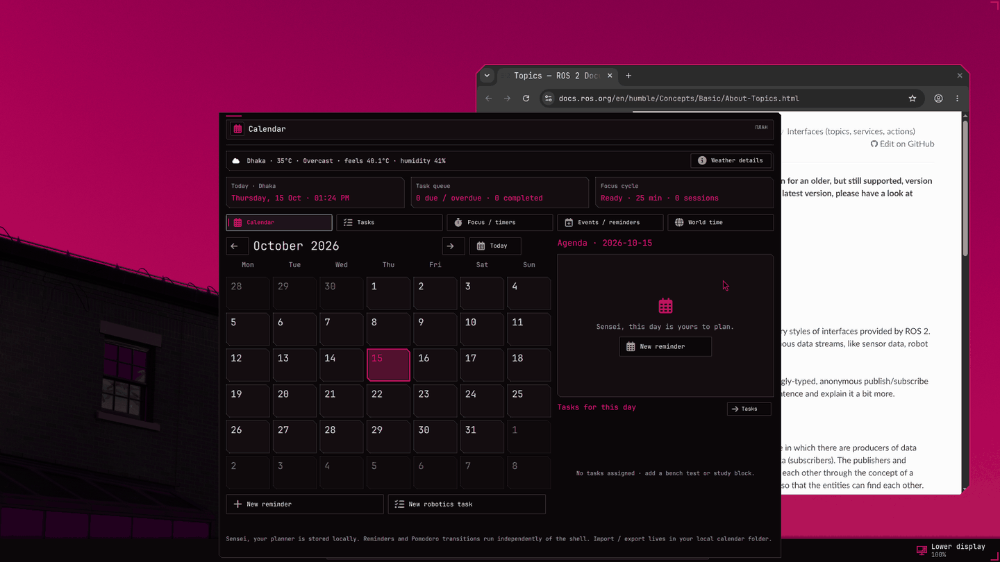

<sub>LOWER // REFERENCE + THE REST OF THE DAY · [Native-size image](docs/assets/digital-den/arete-lower.png)</sub>

ROS docs stay open. Calendar and weather slide into the day without replacing it. The desktop has jobs beyond being a terminal stand.

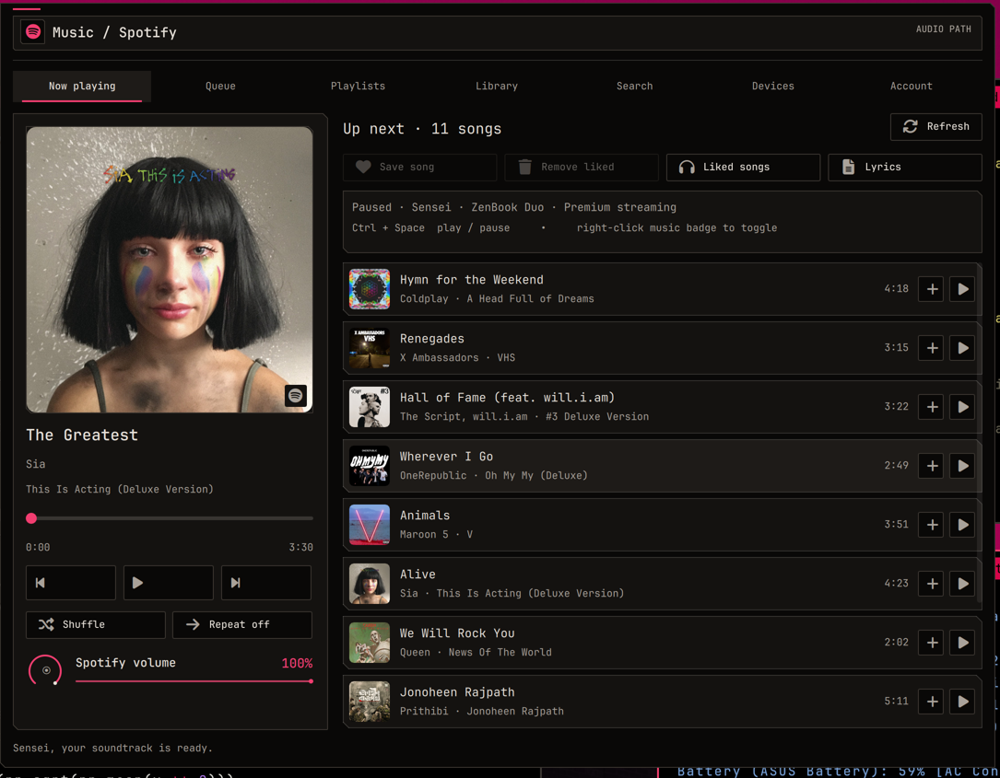

<sub>SOUNDTRACK // QUEUE · LIBRARY · DEVICES · LYRICS · [Audio guide](docs/audio-and-spotify.md)</sub>

Music gets album art and proper controls. The queue is allowed to have a personality. So is the desk.

## 04 / Big brother holds the fort

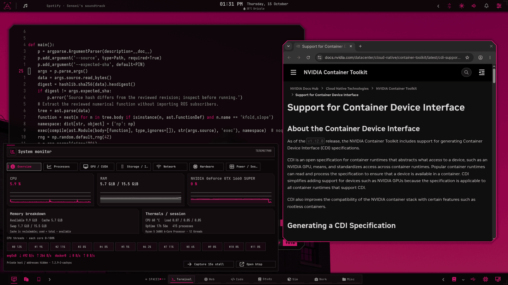

<sub>HOMIE // GPU + STORAGE + THE SAME DESKTOP LANGUAGE · [System](docs/assets/digital-den/homie-system.png) · [Monitor](docs/assets/digital-den/homie-monitor.png) · [Code](docs/assets/digital-den/homie-code.png)</sub>

Same shell, same tools, same visual language. Desktop-specific graphics, display, power and storage policy. Homie keeps the native NVIDIA work and larger files at home; Arete can reach the designated shared storage over SSHFS.

| | Arete · portable lab | Homie · home base |
|---|---|---|
| CPU | i7-9750H · 6 cores / 12 threads | Ryzen 5 3600X · 6 cores / 12 threads |
| Memory | 16 GiB | 16 GiB |
| Graphics | Intel display + RTX 2060 | GTX 1660 SUPER · 6 GiB |
| Displays | 4K main + ScreenPad; two 1080p / 100 Hz externals | LG 1080p / 75 Hz |
| Storage role | Active projects and portable work | Five drives; six preserved, readable volumes |

[Hardware and drives](docs/digital-den/HARDWARE.md) · [Homie setup and boot recovery](pc/README.md)

## 05 / One mouse. A known way home.

Push through the **top of the laptop** to reach Homie, or through the **right edge of the upper external**. Come back through Homie's bottom or left edge. The animated pink wires in the header trace those routes.

| Gesture / control | What it does |
|---|---|
| **Ctrl × 2** | Light up the cursor |
| **Ctrl × 3** | Pause sharing and bring it home; repeat to resume |
| **Ctrl + Alt + Esc** | Release native input capture immediately |
| **System → Digital Den** | Sharing, locator, bring home, storage and status |

Text and PNG clipboard travel both ways. Pairing uses private keys and pinned hosts. The receiver leaves its local keyboard usable. Slight dimming identifies the active display without keeping a blur animation running.

The tiny engineer may lose a semicolon. The mouse should have an escape route.

[Input, clipboard, storage and recovery details](docs/digital-den/README.md)

## 06 / The small screen earns its keep

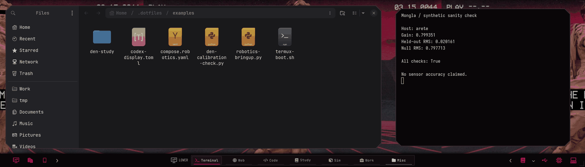

<sub>SCREENPAD // FILES + QUICK RESULTS · [Full-size image](docs/assets/digital-den/arete-screenpad.png)</sub>

A file picker, a result, a monitor, USB diagnostics. Small jobs belong here; the main screen stays available for the hard part.

## 07 / Unplug. The lab comes along.

<picture><source media="(prefers-reduced-motion: reduce)" srcset="docs/assets/duo-hero.png">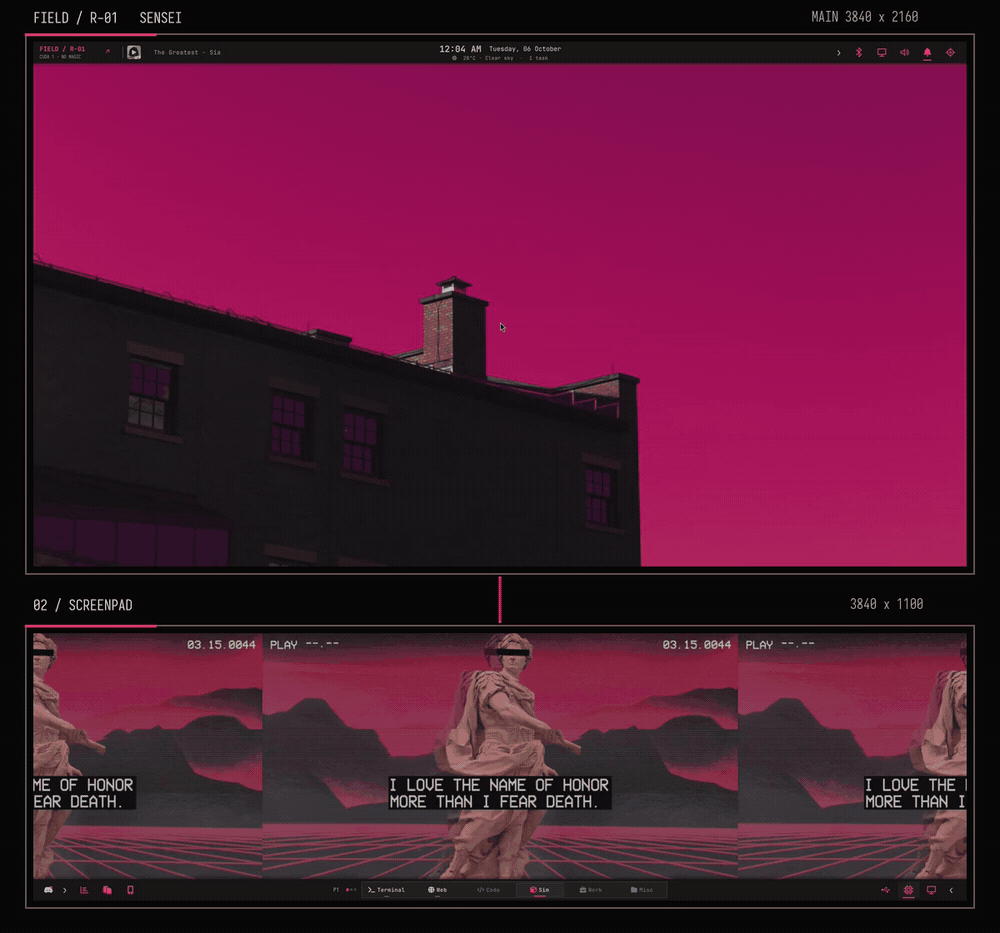</picture>

<sub>PORTABLE MODE // MAIN + SCREENPAD · [Still](docs/assets/duo-hero.png) · [MP4](docs/assets/duo-hero.mp4)</sub>

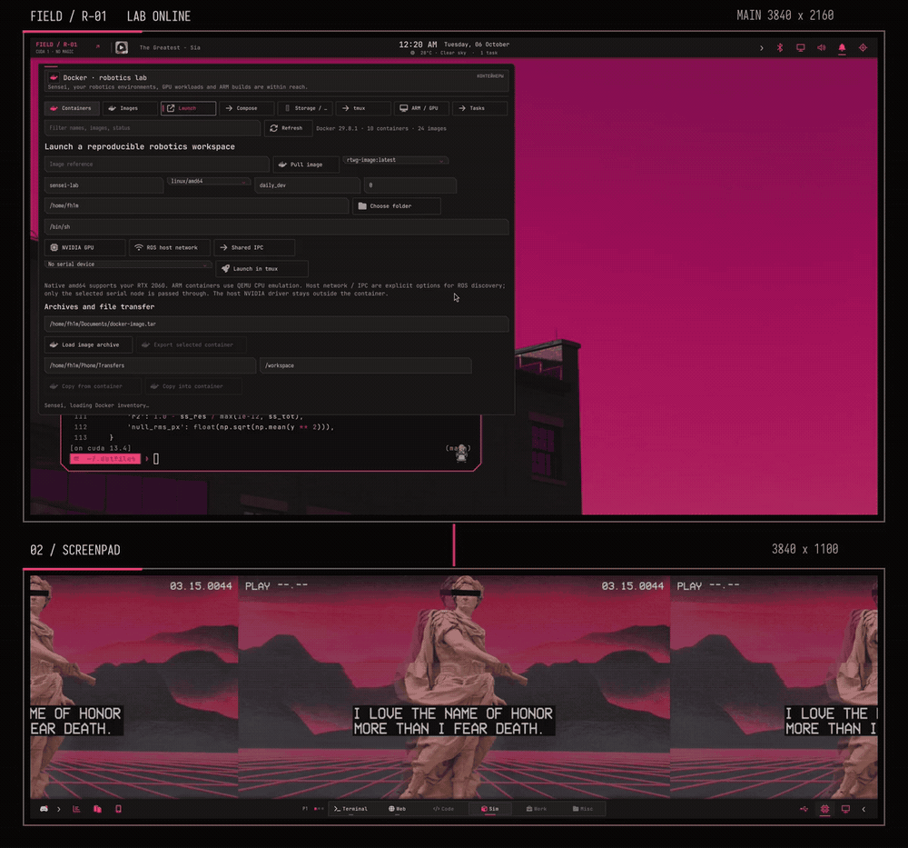

<sub>LAB // DOCKER · COMPOSE · ARM THROUGH QEMU · NVIDIA CDI · TMUX · EXPERIMENT TASKS · [MP4](docs/assets/duo-lab.mp4) · [Lab guide](docs/robotics.md)</sub>

Ubuntu-based robotics environments live in containers. The host remains the daily driver. Serial devices, GPU tooling and project sessions have a place in the same workflow. ARM emulation still runs on the CPU; two GPUs do not magically become one pool of VRAM.

## 08 / A little less solemn

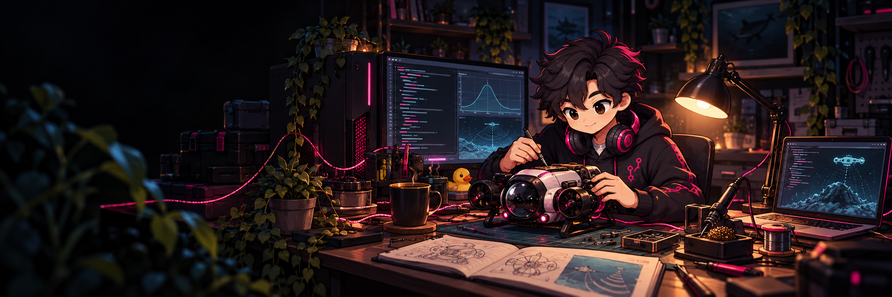

He escaped the README.

<picture><source media="(prefers-reduced-motion: reduce)" srcset="docs/assets/digital-den/companion-local-travel.png">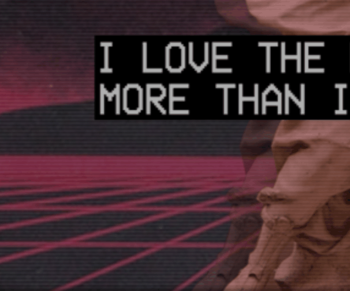</picture>

A small fh1m companion finds a free corner, types, wanders a little, and occasionally has opinions about coordinate frames. Useful tips, small jokes, no sound. Applications always win the space; quiet and reduced-motion controls are one command away. **System → Digital Den → Tour displays / Desk tip.** Try `:DenTip` inside Neovim. [Companion controls](docs/digital-den/README.md#the-little-engineer).

The capture shows local travel; separate live checks verified an exclusive handoff to Homie and return to Arete. [Current implementation and checks](docs/digital-den/NEXT-PASS-IMPLEMENTATION.md).

Native tabs keep Alacritty and Obsidian together. The identity deck has developer tools and a Nerd Talk corner. XKCD is a right-click research break. The palette takes itself seriously enough for the rest of us.

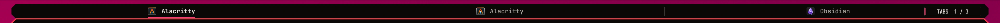

[Comic break](docs/assets/comic.png) · [Every panel, larger](docs/gallery.md) · [Phone bridge](docs/phone.md) · [Keybindings](docs/keybindings.md)

## 09 / Numbers before adjectives

| Measured on Arete | Result |
|---|---|
| Same animated terminal workload | **22.6% → 6.6%** Intel render share after switching to Alacritty |
| Unused ScreenPad touch-controller interrupts | **286/s → 0/s**, with display and brightness retained |
| NVMe busy during an apparent I/O stall | **0.225%**; the investigation pointed to Intel display fences |

*Workload samples, not universal benchmarks.* [Methods and limitations](docs/performance.md).

For the Den baseline: **12 real cross-host cursor routes** exercised with keyboard, clicks and scrolling in an owned test window; text and PNG clipboard checked in both directions; both installers checked for a second run with no changes. [Validation record](docs/digital-den/REPOSITORY-AUDIT.md).

The continuity pass adds **11 mirrored folders**, encrypted restore checks on **both hosts**, seven private Git-history handoffs, and the same small CUDA/autograd check on both GPUs. Homie's desktop streams privately on demand; its Docker engine is one explicit context away. [What was actually tested](docs/digital-den/VALIDATION.md).

## Bring your own workbench

```sh
git clone https://github.com/fh1m/.dotfiles.git ~/.dotfiles
cd ~/.dotfiles
python3 scripts/install.py --hardware zenbook         # preview; use pc on Homie
python3 scripts/install.py --hardware zenbook --apply # backs up replaced files
bash scripts/build-native.sh
python3 scripts/doctor.py
```

**One development branch: `main`.** Shared configuration lives in `home/`; Homie's hardware overlays live in `profiles/pc/home/`. Former branch tips are preserved with archive tags. Notes, browser profiles, credentials, pairing keys and actual datasets stay private.

[Install guide](docs/installation.md) · [Development](docs/development.md) · [Operations](docs/operations.md) · [Known Homie cold-boot gate](pc/BOOT-EXPERIENCE.md)

<div align="center">

<sub>BUILT BY FH1M / FOR THE NEXT THING THAT DOESN'T WORK YET</sub>

<sub>The shell started with <a href="https://github.com/bowenbride/wrayth">Wrayth by bowenbride</a>. Original notices are preserved. <a href="THIRD_PARTY.md">Credits</a> · <a href="docs/digital-den/GALLERY.md">Capture notes and illustration provenance</a></sub>

</div>

## After hours / still building

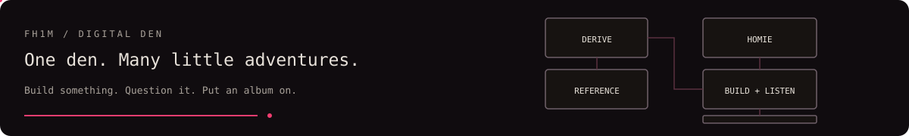

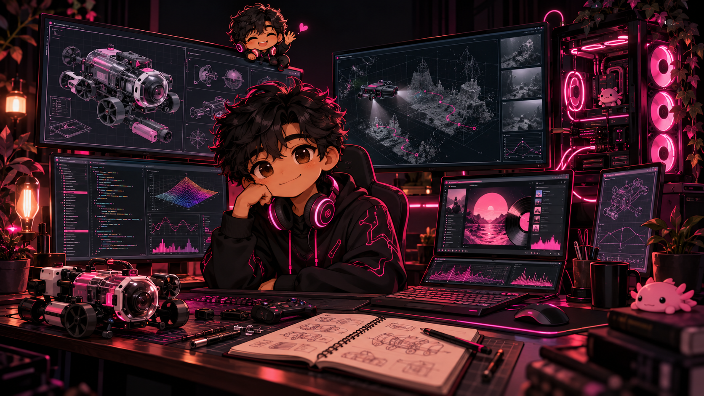

<sub>A bespoke illustration, not a screenshot. The live desktop captures above show what actually runs.</sub>

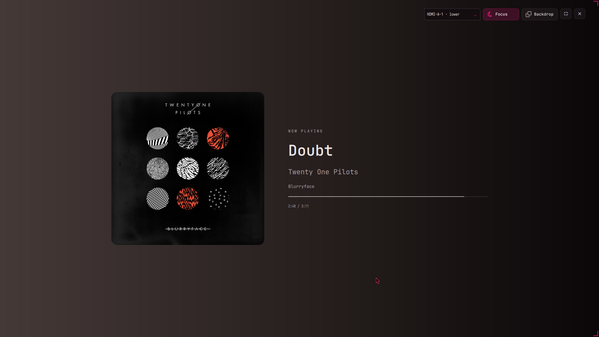

<sub>ACTUAL UI // FOCUS · MOVE BETWEEN DISPLAYS · BACKDROP BEHIND YOUR WORK</sub>

Some nights call for a derivation. Some call for an album and a notebook. The Den has room for both.

- **Listening room:** artwork, lyrics and queue together. Focus strips it back to the cover and song. Move it to another display, or put it behind your work with Backdrop.
- **Zondo, desk-sized troublemaker:** reading, stargazing, gardening, robot wrangling—and dancing when Spotify plays. Project-history callbacks, local repetition memory and notification counts without reading private message bodies. Busy screen? He takes a bar perch instead of sitting on the code.
- **The old tmux buttons are home:** sessions, windows, panes and directory at a glance. No session needs to die for a cosmetic change.
- **The editor has receipts:** a disposable Python fixture checks snippets, parsing, formatting, debugger configuration and real LSP hover on the host and ROS container. The field guide includes the editor’s live mappings and attached-language shortcuts.

> Tiny engineer. Big coordinate-frame problem. We’ll take it one function at a time.

[Music controls](docs/digital-den/MUSIC-LISTENING-ROOM.md) · [Development](docs/development.md) · [This polish pass](docs/digital-den/DEN-POLISH-V3.md)

<details>
<summary>Meet Zondo / a tiny off-duty engineer</summary>

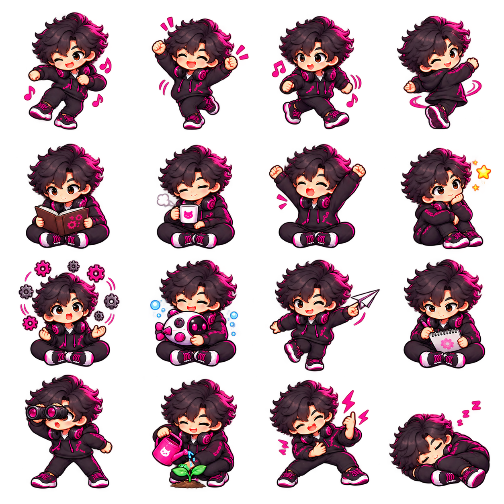

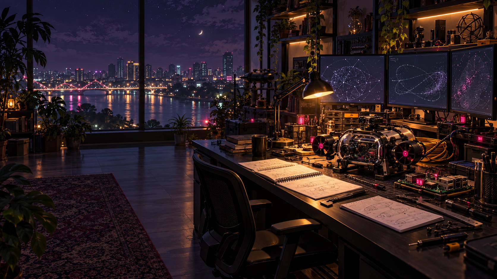

<sub>THE DEN AFTER HOURS // ORIGINAL ARRIVAL ART · LIVE TEXT IS RENDERED BY THE DESKTOP</sub>

Original illustrated sprites used by the live desktop. He climbs familiar rooftops, explores exposed wallpaper across Arete and Homie, takes a bar perch when the desk is busy, and never sits on your code. Talk offers lightweight offline replies; Remember keeps only the words you explicitly save. No online model is running. “More like this” and “Retire this line” keep his repertoire yours. [Controls and privacy](docs/digital-den/ZONDO.md).

</details>
