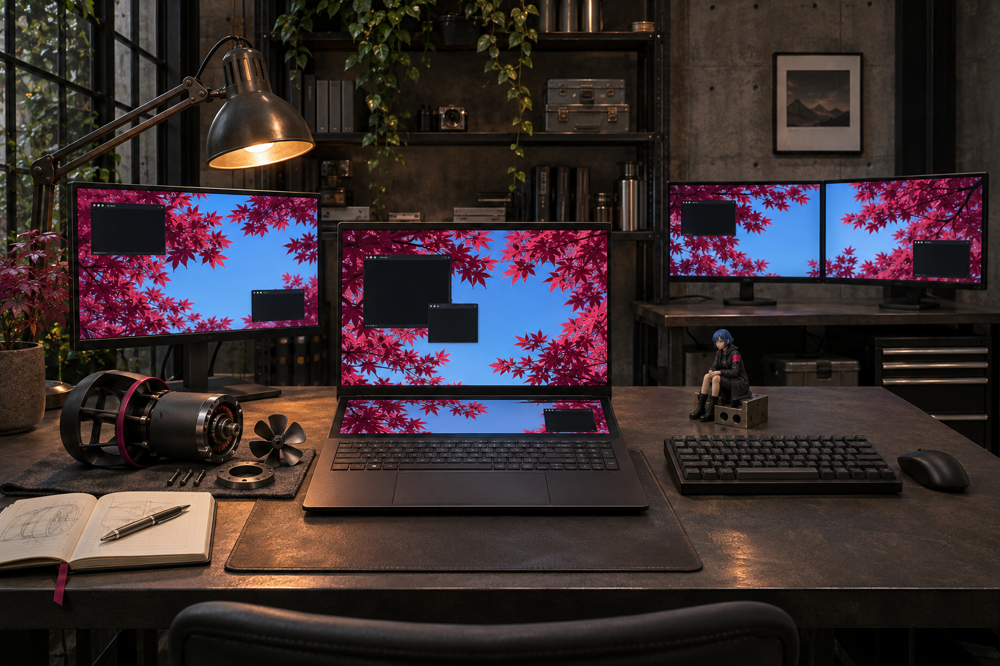
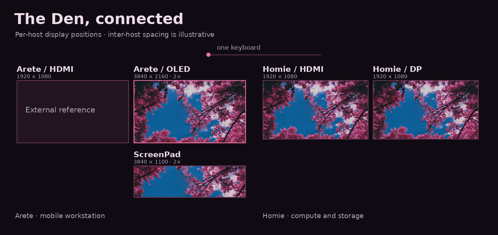
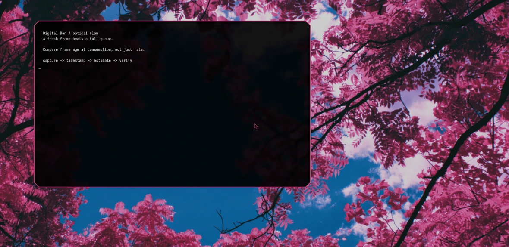
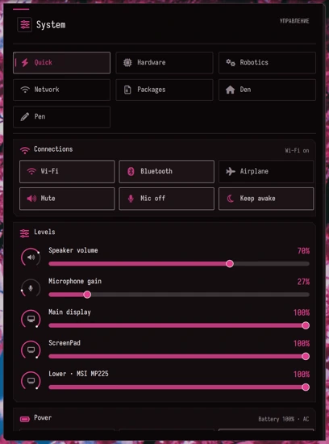
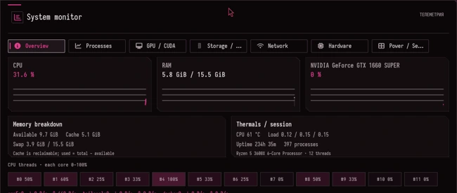
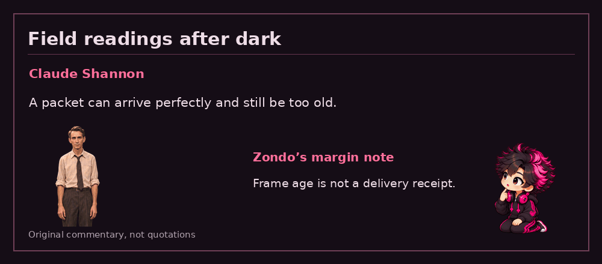
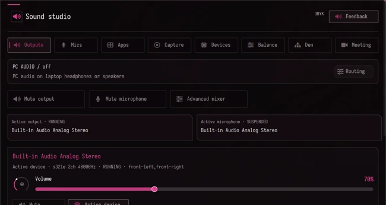

<div align="center">
<h1>Digital Den</h1>
<p>A workstation for things that have to work outside the workstation.</p>

<sub>After dark · original Codex ImageGen illustration. The captures and connector map below show the real desktop.</sub>
<p><a href="#operate-the-den">Controls</a> · <a href="#after-hours--still-building">After hours</a> · <a href="docs/installation.md">Install</a> · <a href="docs/digital-den/VALIDATION.md">Verification</a></p>
</div>

I'm **fh1m**. I build underwater robots and use this desk to trace their behavior from a sensor sample to a moving vehicle. **Arete** is the laptop; **Homie** is the machine that holds the drives and runs the longer jobs. CachyOS, Hyprland, Quickshell, Alacritty, tmux and Neovim make them feel like the same place without pretending they’re the same hardware.

## Five screens, two computers

<picture>
  <source media="(prefers-reduced-motion: reduce)" srcset="docs/assets/digital-den/den-screen-map.webp">
  
</picture>

The map shows **current connector ownership**, not the way a room photograph would look. Each host has its own coordinate system; the gap between them is illustrative. Screens can move between hosts. The OLED supplies Arete’s wallpaper palette; Homie’s primary does the same for Homie. The terminal background stays black. [Hardware and displays](docs/digital-den/HARDWARE.md) · [Previous setups and capture provenance](docs/digital-den/GALLERY.md)

| Surface | What I keep there |
|---|---|
| Arete OLED | Neovim, tmux, live diffs and traces. Set the clock in your logging pipeline before trusting the plot. |
| Arete HDMI | Reference material and the second view of the same workspace. |
| ScreenPad | The utility workspace: a meter, a short checklist, a picker, or a tiny status panel that doesn't take over the editor. |
| Homie primary | Native NVIDIA work, builds, tests, logs and the drives. |
| Homie HDMI | The result or supporting material while the main view is busy. |

## Workbench



The terminal above is a disposable public fixture, not a shot of my private editor. [Mongla](https://github.com/fh1m/mongla_ws) is real: a ROS 2 autonomy stack for underwater vehicles. In the [frame-age experiment](https://fh1m.github.io/notes/the-frame-age-problem), consuming the latest frame mattered more than the throughput counter. The diagram stopped being a diagram when the queue started lying.

- **Code:** Alacritty is the surface; tmux owns the session. Neovim handles LSP, debugging and review. Closing the terminal does not end the workload. [Terminal](docs/terminal.md) · [Editor and development](docs/development.md)
- **Robotics:** RobotBench, USB identities, named simulation environments, and explicit Arete/Homie jobs. Results name the source revision and artifacts; an exit code is not a successful experiment. [Workbench](docs/digital-den/ENGINEERING.md) · [Robotics environments](docs/robotics.md)
- **Study:** Noesis can bring a question, a notebook and a result back to the same place. A checked task is not proof of understanding. [Learning system](docs/learning-system/README.md)
- **Agents:** the Code badge distinguishes providers, accounts and stale readings. Usage bars represent observed limits, not a promise that the next run will fit. [Code badge](docs/learning-system/DESKTOP-CODE.md)

## Operate the Den

<table><tr><td width="47%"></td><td width="53%"></td></tr></table>

| To do this | Start here |
|---|---|
| Get back to the daily shell | **Super+Enter** focuses or opens it. **Super+Shift+Enter** starts an independent session. |
| Find work across displays | **Super+Tab** opens the workspace switcher. **F6** changes the display filter. Pause live previews if stills are enough. |
| Bring the mouse home | **Ctrl × 3** brings it home and pauses sharing; repeat to resume. **Ctrl+Alt+Esc** releases capture. |
| Check what's using the machine | **Monitor** in the bar. Look at memory pressure and available memory, not just the size of file cache. |
| Find the shortcut I forgot | **Super+F2** opens the Field Guide. It reads the available desktop, terminal, tmux and editor bindings. |
| Diagnose a cross-host problem | **System → Den** for status; use the known recovery route before experimenting with focus or shared input. |

[All shortcuts](docs/keybindings.md) · [Den operations and input sharing](docs/digital-den/README.md) · [Performance notes](docs/performance.md) · [Recovery](docs/operations.md)

## After hours / still building

<picture>
  <source media="(prefers-reduced-motion: reduce)" srcset="docs/assets/digital-den/zondo-field-reading.webp">
  
</picture>

Zondo lives in the desktop, not in a chat tab. He reads, sketches, roams when there’s a place to put him, and has the good sense to get out of the way during fullscreen work. He has a stronger opinion about missing receipts than about where you put your taskbar. [Companion controls and privacy](docs/digital-den/ZONDO.md)

<details>
<summary>When the guests stop by</summary>

Shannon is good company when the metrics look suspiciously healthy. Bourdain’s accounts of kitchen work make a good lens for team handoffs: someone needs to leave the next person a clean bench. West’s account of a calmer studio on a demanding second show suggests a useful design question: can the room ask less of us while the work asks more?

The reel is authored commentary, not quotations or a recording of those people. The live reader has **12 guests, 126 source-matched excerpts and 144 sourced readings**, plus separately labeled workshop variations. Zondo’s links to public robotics work are his margin notes, not advice invented in someone else’s voice. [Read the sources and how rotation works](docs/digital-den/SENSEI-GUESTS.md)

</details>

<details>
<summary>Volume up; noise down</summary>



The Sound studio separates outputs, microphones, app streams, meeting controls and the Den route. Homie can play through the laptop’s selected output without requiring both desktops to be in the same app. The listening room makes space for artwork and lyrics; it can move to another display. No spectrum analyzer gets to do background cardio just because the song has a chorus. [Audio routes](docs/audio-and-spotify.md) · [Listening room](docs/digital-den/MUSIC-LISTENING-ROOM.md) · [Media Center](docs/digital-den/MEDIA-CENTER.md)

</details>

<details>
<summary>Small things I miss on other machines</summary>

- **A known way back:** double-tap Ctrl to locate the cursor. Triple-tap to bring it home. The screens should never be better at hide-and-seek than Zondo.
- **A dedicated little screen:** a meter and shortlist are useful. A full-size dashboard crammed into the ScreenPad is just a new reason to squint.
- **A task can outlive its window:** persistent tmux sessions, owned job receipts and retrievable logs. Let the terminal go away. Keep the work.
- **Clipboard history stays useful:** text and PNG can travel across the paired Den; sensitive offers are excluded. [Clipboard and recovery](docs/digital-den/README.md)
- **One knob for attention:** dismiss a guest, pause previews, use quiet mode, or keep a still. The desktop should answer an action, not continually audition for your focus.
- **Even a negative result has a home:** save the test, the wrong prediction and the artifact. The bug will not sign your notebook, so leave it enough evidence to testify later.

</details>

## Install and verify

```sh
git clone https://github.com/fh1m/.dotfiles.git ~/.dotfiles
cd ~/.dotfiles
python3 scripts/install.py --hardware zenbook         # preview; use pc for Homie
python3 scripts/install.py --hardware zenbook --apply  # backup before replacing
bash scripts/build-native.sh
python3 scripts/doctor.py
```

Shared source lives in `home/`; hardware-specific settings are in `profiles/`. Do not copy auth tokens, pairing keys, real clipboard history or private study records. [Install guide](docs/installation.md) · [Observed verification and limits](docs/digital-den/VALIDATION.md) · [Homie cold-boot gate](pc/BOOT-EXPERIENCE.md) · [Historical gallery](docs/gallery.md)

The original shell drew inspiration from [Wrayth by bowenbride](https://github.com/bowenbride/wrayth). [Third-party credits and licenses](THIRD_PARTY.md).
