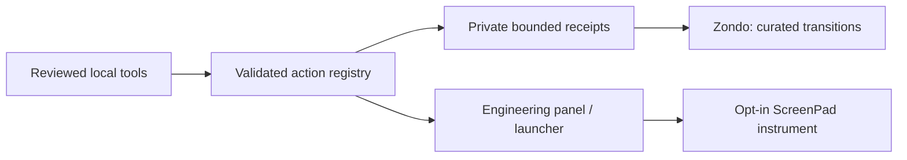

# Engineering, with receipts

**Super+Ctrl+E** opens projects, jobs, experiments, hardware and Zondo. The same reviewed actions appear in launcher search. Choose **Arete or Homie** explicitly. Pin a temporary instrument to ScreenPad when it helps; Return removes it. Main-display widgets remain independent.

## One action, several surfaces



`engineering.py` owns project identities, exact task trust, parameter validation and single-use confirmations. QML is presentation. There is no generic shell action. Both hosts validate independently; an expired confirmation or changed definition requires another review. This is a safety contract within the user's account, not isolation from malicious software already running as that user.

The existing pinned SSH connection carries Arete→Homie actions. Homie→Arete uses the restricted `den-control --serve` gateway: exact engineering executable, no shell, no forwarding, no remote catalog/trust editing. No action falls back to another host or retries an uncertain launch.

## Register an existing checkout

```sh
sensei-actions register robotics ~/Work/robotics --title Robotics
sensei-actions doctor
sensei-actions list
```

Private definitions live in `~/.config/sensei-engineering/projects.json`. Preserve the generated host location. Add only tasks you have inspected:

```json
"tasks": {
  "test": {
    "argv": ["python3", "-m", "unittest", "discover"],
    "inputs": ["tests/test_frames.py"],
    "artifacts": [],
    "resources": {"memoryMiB": 512, "cpuPercent": 100}
  }
}
```

Then `sensei-actions trust robotics test` approves that exact definition. Arguments are an array, never interpolated shell text. Editing the definition invalidates its trust hash. The GUI shows the prepared operation before confirmation. Project dates use the existing calendar task store.

One worker executes per host; at most sixteen jobs may be pending/running. CPU/memory limits are enforced by the owned systemd unit when specified. Input files are hashed again before execution. Receipts retain Git revision, exit code, resource use and artifact hashes; unit inactivity never turns a completed result into a running job. GPU scheduling and VRAM reservation are **not** automatic. Choose a GPU task and its machine deliberately.

## Environments and hardware

Project `environments` support `native`, `compose` and `distrobox`, with `trust-environment PROJECT NAME` approving the exact definition. Compose checks configuration without starting it. A Distrobox definition names its container, optional `ros_setup` under `/opt/ros/`, and explicit `ros_domain_id`. ROS graph snapshots are bounded discovery, not proof of sensor accuracy or vehicle safety; no subscription-rate probe or vehicle command runs automatically.

Register a connected device in Hardware or with:

```sh
sensei-hardware register imu-adapter --node /dev/ttyACM0 \
  --label 'IMU adapter' --project robotics --baud 115200
```

The private passport can retain known firmware and a reviewed diagnostic task. Identity follows serial/vendor/interface or a physical udev path. Multiple matches are ambiguous, never silently selected. Discovery never opens a serial port, changes permissions or flashes firmware. The watcher waits for udev events instead of polling every ten seconds. Physical disconnect acceptance still needs the actual board.

## Experiments and evidence

```sh
sensei-lab run --project ~/Work/robotics --name static-drift \
  --parameters parameters.json --input calibration.json \
  --metrics metrics.json --artifact plot.png \
  --baseline /path/to/previous/run.json -- python3 evaluate.py
```

Metrics are a JSON list, for example `[{"name":"drift","value":0.02,"unit":"m/s"}]`. Use `dimensionless` explicitly. Values must be finite. Comparisons require matching name/step and units. Changed inputs, parameters, project or revision are flagged; a negative delta is not declared an improvement. A passing process is not a verified hypothesis. Nested jobs pass a parent job identity into the lab receipt.

**Capture evidence** opens area selection after confirmation. A run-linked capture checks the receipt belongs to the project, preserves its checksum and a bounded log attachment, and opens an observation note in the active vault. Cancel selection to save nothing. Screenshots/notes remain private; publication is separate.

`sensei-mcap-capture --help` describes explicit topic, duration and size bounds. It never records every topic implicitly. It adapts to the installed ROS CLI. Size is sampled, so a fast recorder can exceed the threshold between samples. A real Fast DDS fixture recorded a verified topic; Cyclone loopback fixtures were empty and are not reported as passing. The machine's normal middleware was preserved.

## Dates, displays and Zondo

Calendar owns tasks. Noesis owns learning reviews; Calendar projects their source-qualified IDs read-only and opens Noesis for editing. Conflicting review plans, duplicate vault identities, retired plans and already-attempted reviews are not guessed into dates. The projection uses existing Noesis caches; open/reconcile the vault if its review view is stale. Planner's original daily workflow remains available beside Agenda.

The display editor supports dragging, advertised modes, scale, rotation, mirroring and a main display. Apply arms an independent **20-second rollback worker before changing outputs**; Keep alone saves a hardware-conditional profile. ScreenPad remains a utility output. `nwg-displays` is recovery tooling. The editor changes its own host; it does not silently rearrange the other computer. A real same-geometry rollback was tested. Rotation, changed primary and physical cable transitions were not exercised in this pass.

Zondo has 24 additional original activities and a 160-line curated pool. High-five, boat, tea and short puzzles are local interactions. Event messages come from bounded project/job/experiment/hardware receipts, not unrestricted application contents. Logs and arbitrary commands never enter his cross-host event projection. Receipt links keep the source host; repeated failures suggest inspecting evidence. Quiet, DND, fullscreen and reduced motion take priority. No online conversation model runs. He may travel through the existing Den lease system; “local” describes conversation privacy, not confinement to one computer.

## Storage, recovery and undo

| Owner | Durable data | Recovery |
|---|---|---|
| Dotfiles | Code, templates, sprites and defaults | Git, normal profile installer |
| Private engineering config | Projects, task trust and hardware passports | Encrypted Restic scope |
| Private state | Jobs, labs, transition receipts, display transaction | Encrypted Restic scope; inspect receipts |
| Vault / project | Reasoning, screenshots, actual code | Existing vault/project backup policy |
| External data | Bags, datasets, recordings | Explicit storage/data policy; not public Git |

Both hosts' existing encrypted backup scopes now include engineering config/state, lab receipts and job history. A marker snapshot and the actual project catalogs from new encrypted engineering checkpoints were restored to separate directories with matching SHA256. This verifies those recovery paths, not every byte of every backup. Homie’s missing Restic package was installed; it is now declared in the core manifest and checked by doctor. Peer backup is not off-site protection.

Installer backups preserve replaced files. Disable integration by removing the Engineering binding/panel route through a reviewed dotfiles change; private receipts and project definitions need not be deleted. Confirmed display preferences live in private `monitors-user.lua`/JSON; keep a backup before removing them and use the editor's reset/recovery controls. Input has its own emergency path: **Ctrl+Alt+Esc**, or triple Ctrl to release/centre and again to resume. Do not remove private keys/configs to uninstall a widget.

Verification commands: `sensei-actions doctor`, `sensei-hardware list`, `sensei-den job list`, `sensei-den backup restore-test`, and `python3 -m unittest discover -s tests`. Live input tests are explicit opt-in and use an independent expiry timer; never import a harness to control a desktop.
