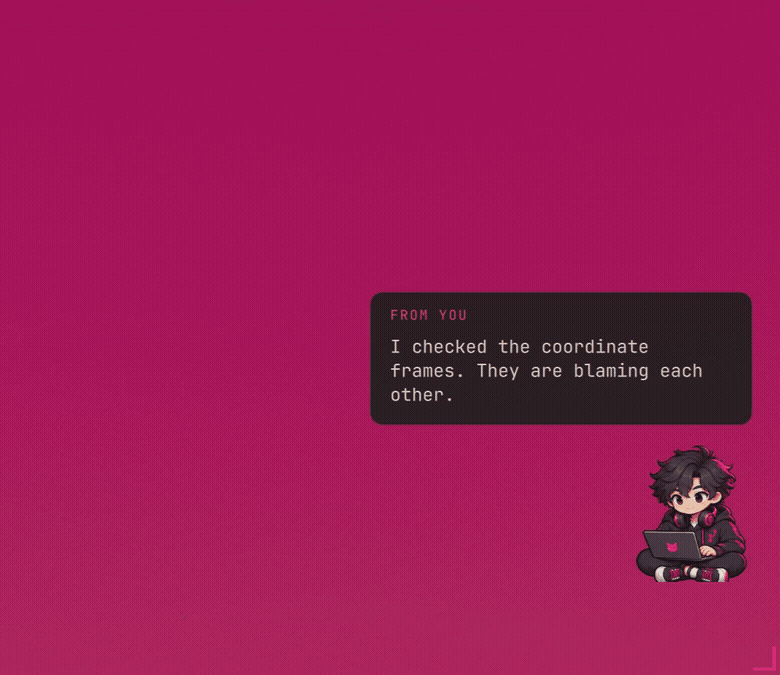

# The Den, as a real workspace

The header follows the physical desk: Arete's two external monitors stacked at
left, Homie's display at upper right, laptop main below it, then ScreenPad.
The room photo is neither published nor embedded.

## Screens and motion

These are reviewed Grim captures of actual applications, arranged proportionally
inside illustrated monitor frames. They form a spatial collage, not a synchronized
five-screen video. Each screen uses its own captured sequence where available.
The Obsidian reading view stays still; code navigation, browser scrolling, native
panels and live telemetry change on the other displays. Pink route signals, a
brief title echo and typewriter text are illustrative effects outside the screens.
The hero has a reduced-motion poster and each workspace has a full-resolution PNG.

- Main: Neovim, tmux and an anonymous browser on Mongla's GitHub repository.
- Upper: native Obsidian with the public calibration example, MathJax and Canvas.
- Lower: ROS 2 Humble documentation, Calendar and Weather.
- ScreenPad: the public examples folder and the executed numerical-check summary.
- Homie: Neovim, NVIDIA CDI documentation, native System and live Monitor samples.

The code visible in the current editor captures is this repository's actual
`examples/den-calibration-check.py`, executed on both hosts. The underlying
Mongla calibration function is pinned to revision
`c67a0805206b88a25e541a5fe0c3a95afb168b40`, SHA256
`2830bfaf0b8c0922ca4eafe74377645481631bf2abf489b335cf2c288599796f`.
No physical sensor or running vehicle is implied.

Public study files live in `examples/den-study/`. They are prepared engineering
examples, not private learner notes or evidence of anyone's mastery. A separate
Obsidian profile and owned temporary windows kept private content out of capture.
Privacy mode suppresses private notifications and supplies planner placeholders;
calendar values are not a disclosure of the author's private agenda. Hardware
telemetry is a live sample, not a benchmark.

The old capture setup's invalid Neovim diagnostic command was removed. The new
example was checked with the installed language tooling, and visible frames were
reviewed again. Error screens are excluded. Original user windows were parked
without closing them, protected by independent restore timers, and restored after
capture. Sharing was resumed. Private capture staging and browser profiles remain
outside Git.

The four-pose hoodie avatar was generated with OpenAI image generation for this
README, then cropped into a typing loop. It is a fictional fh1m stand-in, not a
photographic likeness. `fh1m-sprites.png` retains the transparent source sheet.
The author requested the character and playful motion; neither implies a real
screen recording of a person typing.

Older portable tours and music screenshots retain their original capture dates
and methods. They illustrate the portable setup and native music interface;
they are not current live playback claims.

## The desktop companion

`companion.gif` and `companion.png` are actual captures of the running companion
on an empty Arete workspace, with its existing wallpaper. The capture restored
the previous workspace, focus and companion preferences. No application error,
private note, account page or fabricated application screen is in these assets.

The eight-pose transparent sheet at
`home/.local/share/sensei-companion/fh1m-poses.png` was generated with OpenAI image
generation on 2026-10-15. Brief: extend the README's fictional dark-haired hoodie
engineer into typing, blink, thinking, wave, left/right walk, celebration and sleep
poses, retaining the hot-pink circuit/headphone details. It is a 1774 × 887 RGBA
sheet. QML crops the cells at render time. Movement is a gentle window-position
animation; the left/right illustrations are directions, not alternating gait
frames. There is no audio or ChatGPT pet dependency.

## Rebuild the composition

```sh
python3 scripts/compose-den-gallery.py /path/to/reviewed/captures
```

Requires Pillow and DejaVu Sans. Inputs are `frames/<screen>-00.png` etc., for
`arete-main`, `arete-upper`, `arete-lower`, `arete-screenpad`, `homie-live`.
A `<screen>.png` still is accepted when a frame sequence is unavailable.
The maintained sprite sheet must exist in the output directory. Composition
never reads the private room photo and does not retouch application contents.

## Reproduce the numerical check

Requires Python and NumPy. Review the public upstream source before running it:

```sh
curl --fail --location \
  https://raw.githubusercontent.com/fh1m/mongla_ws/c67a0805206b88a25e541a5fe0c3a95afb168b40/tools/flow_derot_calibrate.py \
  --output /tmp/mongla-flow-calibrate.py
python3 examples/den-calibration-check.py --source /tmp/mongla-flow-calibrate.py
```

The script verifies the file hash, extracts only the reviewed `kfold_slope`
function, and uses deterministic dimensionless synthetic data. Both machines
returned gain `0.7993510846`, held-out RMS `0.02016117985` and null RMS
`0.7977129094`, passing four sanity checks. This tests numerical portability and
model behavior; it does not establish real sensor accuracy, distributed training,
or GPU performance.


## Companion polish / second shift



[Still](../assets/digital-den/companion-v2.png). Captured in the actual compositor
on a temporary empty workspace, restored afterward. The generated night-shift
illustration in the README is artwork, not a screenshot or claim of a physical
desk arrangement. The live character checks free space and yields to applications.
See [asset provenance and prompts](ARTWORK.md).

## Local travel update — 2026-10-16

`companion-local-travel.gif` and its PNG fallback are fresh Grim captures of the
actual QML companion on ScreenPad Utility. They show a short landing scale
animation and plain text over the existing wallpaper. Frames are cropped at the
output's real scale; application contents were not repainted. The character is
the existing exclusive artwork, not a newly generated identity. The text was
explicitly supplied for this capture, not inferred from private work.

This is a **local** capture. Homie was offline, so these assets do not demonstrate
cross-host travel or a synchronized five-panel session. The original spatial
gallery remains intact.
