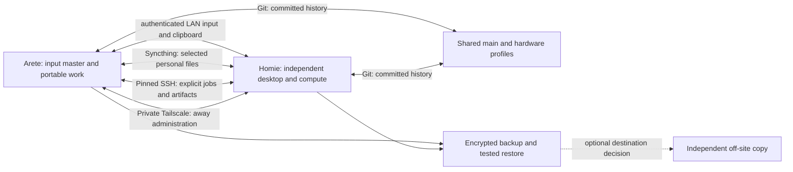

# Digital Den: next implementation pass

2026-10-16. **Proposed; implementation awaits review.** Baseline main: `3c5a53e`.
Only research, source inspection and read-only diagnostics were performed for this
plan. The preceding repair pass is recorded in AUDIT-2026-10-16.md. Existing bars
and valid authenticated sessions remain intact.

## Diagnosis

The Den already has shared source/profile deployment, pinned private SSH,
Tailscale, event-driven shared input, text/PNG clipboard, personal mirrors,
encrypted recovery, remote jobs, two usable CUDA environments, ROS transport,
on-demand private streaming and the bespoke text-speaking companion. Codex and
Claude authentication was independently confirmed on both hosts. Those are things
to preserve and extend, not reinstall or replace.

The unresolved areas are uneven contract coverage, physical acceptance, Spotify
application quota/Connect ownership, and convenience during host/display handoff.
Additional widgets cannot repair those boundaries.

### Source-backed findings

| Finding | Evidence | Consequence / next test |
|---|---|---|
| Six-subject helper versus seven-subject rail | `home/.local/bin/sensei-displays:21,210,214,229,268,285`; `services/Spaces.qml` has seven names | Read-only mocked call `workspace(7,'DP-1')` emits only global workspace 7. `physical(7,'DP-1',{'DP-1':2}) == 7`; `logical(207) == 207`. Misc is not routed like subjects 1–6. |
| ScreenPad utility and Misc share historical workspace 7 assumptions | Same helper plus `home/.config/hypr/oasis.lua` | Separate utility identity from the seven subjects through an explicit reversible migration. Do not simply change six ranges and move existing user windows accidentally. |
| Main-display helper still excludes connector DP-2 | `sensei-displays:217` | A synthetic desktop with only DP-2 yields no main from this helper, although the role resolver can identify a PC main. This is a synthetic portability defect, not a claim that today's DP-3 is broken. |
| Both music configurations use the public ncspot ID | Read local TOML and compared with vendored `NCSPOT_CLIENT_ID`; repeated on Homie, exposing no values | Shared application quota is a plausible contributor to 429s. It is not proof that every playback failure has this cause. |
| Music uses several independently important paths | `src/spotify/transport.c`, `sensei-spotify`, vendored client middleware | Validate local transport, external Connect, catalogue and token refresh separately. Never replay a non-idempotent skip as a retry. |
| Physical tests remain open | Current audit/validation ledger | Software recovery and firmware readback do not establish cold boot, Windows return, cable switching or suspend acceptance. |
| Practical capacity differs from the aspirational cluster | Current hardware ledger and fresh disk-usage reads | Laptop link measured 100 Mb/s; writable Datasets has ~101.3 GiB free, Storage ~126.4 GiB. Read-only Windows/archive free space is not available working capacity. |

## Architecture to preserve



Git owns source/history. The mirror owns selected plain files, not live Git or
application databases. Each host owns its active OS session, credentials, machine
identity, hardware policy and compositor. A shared conceptual workspace is not a
single Hyprland workspace spanning two computers. Keep those distinctions visible.

Physical layout remains:

```text
Arete upper external       Homie main
Arete lower external       Arete main
                           Arete ScreenPad
```

Use EDID identities and logical roles; connector names are host-local adapters.
A moved display must receive the host's policy, not laptop GPU settings on Homie.

## Evidence and decisions

The search ledger records **100 queries across 25 groups plus four HN follow-ups**.
Search coverage is not a benchmark or a count of deeply reviewed studies.

| Evidence | Class / limitation | Decision reflected in the plan |
|---|---|---|
| [spotify-player authentication/rate-limit documentation](https://github.com/aome510/spotify-player#client-id-and-rate-limits) | Current upstream primary documentation; differs from our pinned vendor revision | Investigate a dedicated application identity with the provider's current registration rules. Preserve the working client/tokens until staged authorization succeeds. Do not transplant current upstream auth code blindly. |
| [Spotify rate limits](https://developer.spotify.com/documentation/web-api/concepts/rate-limits) | Provider primary docs; limits are not a published universal request allowance | Respect Retry-After, distinguish application rate limits from quota exhaustion, and cache catalogue results. A personal app is not a guarantee of unlimited access. |
| [librespot Connect transfer issue](https://github.com/librespot-org/librespot/issues/1459) | Maintainer issue / user reproduction; not our reproduction | Add exact-position transfer tests. Do not infer the upstream issue explains our installed build. |
| [PyTorch DDP](https://docs.pytorch.org/tutorials/intermediate/ddp_tutorial.html) | Primary implementation guidance; synchronizing workers can wait on slower peers | Start with independent jobs. Add measured two-node DDP only after comparing identical workloads and recording communication cost. No pooled-VRAM claim. |
| [Qt Quick performance](https://doc.qt.io/qt-6/qtquick-performance.html) | Primary general guidance; no benchmark of this laptop | Reuse the current QML renderer, animate properties in short bursts and measure actual idle/open/animation cost. |
| [wl_shimeji support statement](https://github.com/CluelessCatBurger/wl_shimeji) | Primary project support boundary explicitly excludes official Hyprland support | Keep our existing companion; do not introduce this compatibility dependency. |
| [Syncthing FAQ](https://docs.syncthing.net/users/faq.html) | Primary operational guidance | Keep paired devices and existing loopback API boundaries. Keep Git/application-state handoffs separate. |
| [Restic repository verification](https://restic.readthedocs.io/en/stable/045_working_with_repos.html) | Primary recovery guidance | Preserve sampled-data checks and separate-directory restore proofs; choose independent off-site protection separately. |
| [HN Git/Syncthing discussion](https://news.ycombinator.com/item?id=27153129) | Anecdotal; replies disagree | Test actual conflict/interruption behavior instead of asserting community consensus. Do not extend mirroring into live .git directories. |
| [HN Ball discussion](https://news.ycombinator.com/item?id=40793465) | Playful practitioner discussion, much of it satire | Add optional delight without treating it as measured productivity or adding mandatory assistant services. |
| [Unixporn multi-monitor example](https://www.reddit.com/r/unixporn/comments/ui4j87/gnome_a_dual_monitor_abomination/) | Visual/practitioner context, not technical evidence | Give displays distinct jobs and preserve wallpaper/negative space. Extra screen area does not require duplicated panels. |
| [fh1m about-page source](https://github.com/fh1m/fh1m.github.io/blob/HEAD/src/routes/about/%2Bpage.svelte) | Primary self-description; direct site retrieval failed | Ground the tone in autonomy, sensors, mechanisms and measured behavior. Avoid unrelated gamer decoration or invented biographical claims. |

Old ROS 1, obsolete backup-version results and vendor performance claims were not
used as proof for this setup. New tools such as Ray, Slurm, another pet engine or
a web dashboard are candidates only if the current smaller system cannot meet a
measured requirement. No new framework is justified yet.

## Implementation sequence

### P0 — One consistent display/workspace contract

**Why:** Fix the verified Misc/ScreenPad ambiguity before any presentation work.

Reuse `den_layout.py`, `sensei-displays`, current workspace rails and app rules.
Likely changes: those modules, `hypr/oasis.lua`, `services/Spaces.qml`, role/profile
settings, `docs/keybindings.md` and focused display-routing tests. The current
keybinding table also still lists six subjects in an obsolete order; documentation
will be generated or checked against the same contract.

- Define seven shared subjects in one maintained contract.
- Give ScreenPad utility its own identity. Candidate: workspace 90, but only after
  checking collision with existing user workspaces; it is not a new subject.
- Produce a migration manifest before changing the live session: old/new IDs,
  owning output, affected window addresses, active workspace and focus.
- Reuse role resolution for main/ScreenPad rather than excluding PC DP-2 by name.
- Reconcile capture mappings on topology changes without overriding manual pause.
  Release capture before rebuilding a route; never move the user's cursor from a
  stale generation. Recovery must choose a currently visible output.

**Tests:** Seven subjects × all connected output roles; PC-only DP-2; two identical
model panels with different identities; missing upper/main/ScreenPad; repeated
hotplug; native owned-window navigation/move/return and all input edge combinations.

**Done when:** Misc stays on its requested display, all rails agree about the
logical subject, utility windows stay utility windows, and loss of an output
returns control to a visible panel. Existing window identities and drafts survive.

**Rollback:** Stop capture, restore role/config snapshots and reverse only the
recorded owned migration. Complexity: medium; primary risk is misclassifying a
user's existing workspace-7 window. Resolve that from the manifest, not guesswork.

### P1 — Music ownership and quota isolation

**Why:** 429 persists despite local budgets; do not keep increasing retry counts.

Reuse the native transport and persistent gate. Modules: `sensei-spotify`,
`src/spotify/transport.c`, vendored middleware, music service/QML and music tests.

- Inventory app/client roles privately and compare pinned versus upstream changes.
- If current provider eligibility permits, stage a dedicated client and explicit
  per-host authorization. Keep the old configuration recoverable; do not automate
  a provider enrollment or overwrite a valid session while testing.
- Give each Connect device an unambiguous host name. Track local, external and
  unknown ownership separately; local status must not overwrite external state.
- Keep Next/Previous single-shot, model commands in flight, and distinguish lost
  acknowledgement from a command known not to have been sent.
- Catalogue refreshes are on-demand/coalesced; failed refreshes retain saved data.
  Do not advertise local remaining budget as Spotify account quota.

**Tests:** local playback, external phone control, source→receiver and reverse
transfer, rapid deliberate skips, pause during transfer, refresh expiry, loss of
network and two simultaneous controllers. Mock tests first, then owned live music
acceptance with the previous state restored. Record API counts and position drift.

**Done when:** One activation produces one skip; external control does not cause
local takeover; transfer resumes at the expected position within a measured
bound; catalogue throttling does not break local controls. Provider refusal stays
an explicit blocked capability, not a fabricated success. Complexity: medium/high.

### P2 — Portable/docked/desktop continuity

Reuse `den mode`, the existing watcher, storage/clipboard services and project
handoff. Modules: `sensei-den`, `den-control`, `pc/den`, `setup-den-{apps,projects,sync}`.

- Validate Arete alone, together, Homie alone, peer loss and return as transitions.
- Keep host-specific credentials and valid logins. Transfer missing selected
  durable settings only; no browser-profile or live auth-database replication.
- Verify text/PNG clipboard, modifier release, lost-peer recovery, local Homie
  input and manual pause across reconnect. No clipboard payloads in public logs.
- Resume a real project in the correct host/container, using an explicit commit
  and environment. Demonstrate independent persistent jobs after Arete disconnects.

**Done when:** Leaving preserves local work and recoverable remote jobs; returning
cannot unexpectedly capture input or overwrite edits. Rollback: restore private
handoff configuration and pause new automation. Complexity: medium; depends on P0.

### P3 — Display transfer and desktop boot acceptance

Reuse existing EDID role profiles, hardware-specific deployment, boot guard and
private boot-audit service. Do not replace the repaired working fallback loader.

- Prepare Homie for the two MSI panels at their advertised digital modes; test
  unknown connectors in disposable fixtures before physical transfer.
- Verify bars, widgets, switchers, fonts and brightness against the initiating
  output, both with and without Arete. Keep unsupported DDC explicit.
- Schedule saved-work physical cable/suspend tests and an unattended Linux boot,
  native verified Windows startup and return. These require actual observation.
- Identify the USB -71 device/port before any targeted intervention. Do not reset
  a whole input controller as an exploratory shortcut.

**Done when:** Actual transferred panels retain readable rendering, routing and
refresh modes; native boot cycles are witnessed and audit evidence agrees.
Rollback: retain known-good cables, firmware state, EFI backups and host profiles.
Complexity: medium plus hardware coordination. No monitor-switch purchase assumed.

### P4 — Storage and useful two-host compute

Reuse five-drive layout, read-only protections, Restic, Docker contexts and owned
job receipts. Modules: Den job/artifact helpers, `check-den-ros.py`, targeted
compute acceptance scripts and documentation.

- Keep system SSD, writable Datasets/Storage and protected installations distinct.
  Do not count protected-volume free space as available scratch capacity.
- Run an actual robotics/data workflow: pinned code → checked input → owned job →
  logs/plot/artifact → checksum → local review. Keep data local to its compute host.
- Run one comparable workload independently on each GPU, then a small two-node
  gradient/checkpoint test. Record wall time, network traffic, VRAM and correctness.
  Enable DDP as a supported recipe only if results justify it; independent sweeps
  remain useful even if DDP is slower. This is not combined 12-GB model memory.
- Add retention previews and space-reserve failures, not automatic dataset deletion.

**Done when:** A job survives the laptop leaving, its result is traceable to code
and data, and either node can recover a checkpoint. No speedup claim without a
measured baseline. Rollback: stop only owned jobs/temporary firewall rules and
remove only generated fixtures. Complexity: medium; no scheduler daemon initially.

### P5 — Companion and visual polish

Keep existing artwork, hot-pink/warm-dark palette, readable typography and current
bar buttons. Files: `sensei-companion/{Companion.qml,CompanionLogic.js,notes.json}`,
shared styles, System controls, artwork provenance and gallery scripts.

- Keep a single companion owned by the active context. No duplicate pets on every
  monitor, no across-screen flight, and no obstruction of text, dialogs or controls.
- Expand controlled idle/blink/think/walk states and genuinely distinct short
  text. Chatter, motion, quiet, lock/fullscreen suppression remain independent.
- Use curated engineering wit and useful context: coordinate-frame reminders,
  explicit job completion or a new backup result. Never invent a passing test,
  a learning achievement, an attributed quote or a command the user executed.
- Add a compact bench/field identity language to existing surfaces. Proposed
  optional context rows live inside existing widgets first. New bar controls get
  individual review, consistent with the request to restore the old buttons.
- If new poses/backgrounds are warranted, use imagegen with the established
  character reference, version assets and validate alpha/cell alignment. No stock
  mascot pack, extra assistant subscription or replacement web renderer.

**Done when:** Reviewed live captures demonstrate text/motion without clipping,
click interception or covering work; reduced motion works; current preferences
survive deployment. Measure idle/animated cost against the existing renderer on
both GPUs, and disable unnecessary work when hidden. Complexity: medium.

### P6 — One coherent release and visual story

Small commits on shared main, profile-specific installation, no divergent PC fork.
Update the existing physically oriented gallery with real robotics code, browser,
Obsidian, planner, music and experiment output. Use separate private capture
profiles and reviewed frames, never account errors or private material. Preserve
reduced-motion posters and native-size images. Label composited route effects and
synthetic measurements honestly.

**Done when:** Both hosts have identical reviewed revisions, clean worktrees,
zero installer drift, passing health/backup/input/journey checks and matching
installed root helpers where applicable. No owned fixture or expiry timer is
left running. Normal sharing is restored. Open hardware/provider gates remain
visible rather than hidden behind a generic 'all done'.

## Test ownership and stop conditions

Live input uses an owned receiver, both peers' independent expiry timers, a
finally cleanup and capture-native escape. Do not type/click into user apps.
Do not reboot, power-cycle, reset USB controllers, change partitions or flash
firmware during an unsaved daily-driver session. Broad access enables repairs;
it does not make physical observation or a provider approval automatable.

Measure common-action latency and resource cost before choosing budgets. Keep
private evidence outside Git. Synthetic/hardware/UI/provider tests have separate
results. Recheck upstream issues before proposing a PR; a local workaround is not
an automatically upstream-worthy patch.

## Approval boundary

This document is the proposed next pass, not a claim that P0–P6 were implemented.
Recommended first implementation: P0 routing contract, then P1 music, then P2/P3
continuity acceptance. Compute and extra cosmetic work follow those foundations.
