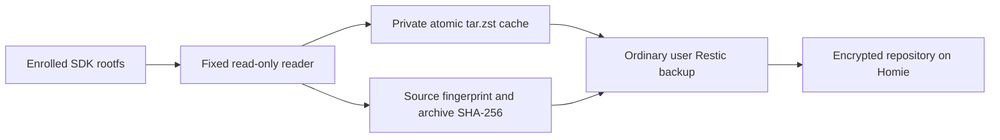

# Protected SDKs without a root backup agent

An extracted robotics SDK may contain root-owned files that the ordinary user
backup cannot read. Do not chmod/chown the SDK, call an incomplete snapshot
successful, or silently omit customizations.

## Boundary

The approved reader has two operations, `inspect` and `export`, and one enrolled
directory. Its root-owned policy pins the directory's device and inode. Replacing
or symlinking that directory requires explicit re-enrollment. It accepts no path,
command, output filename or network endpoint from its caller.

- `inspect`: bounded metadata fingerprint; symlinks are not followed.
- `export`: read-only tar/zstd stream, numeric ownership, permissions, ACLs,
  extended attributes and sparse files; no inherited tar/compressor options.
- Root identity supplies file-read access, not an interactive shell. The real
  desktop UID permits cancellation. The reader runs at nice 19 with CPU, wall
  time and output-size bounds. Compression uses one worker.
- No daemon, saved sudo password, general passwordless sudo, SDK permission
  changes or root-owned user configuration.



`protected_backup.py` compares metadata before and after export. Failure or
source mutation preserves the previous archive. It drains bounded diagnostics,
uses private temporary files and commits the archive atomically. Unchanged
source and archive identities reuse the cache instead of recompressing daily.

Only after preparation succeeds does the ordinary backup exclude the unreadable
live tree and include its complete archive. Both are represented by one regular
Restic snapshot, so existing retention and peer-copy semantics still apply.
Failed preparation is a failed backup, never permission to drop the source.

## Install deliberately

Run the reviewed installer from the repository as the desktop user. Set
`SDK_ROOTFS` to the actual SDK directory ending in `rootfs`:

```sh
sudo /usr/bin/python3 -I scripts/install-protected-rootfs.py \
  --source "$SDK_ROOTFS" --user "$(id -un)"
# Inspect the reported scope, then repeat with --apply.
```

The installer validates sudoers, installs root-owned copies and retains a private
rollback manifest under `/var/backups/sensei-protected-rootfs/`. It does not
execute a root reader from the writable Git checkout.

Enable `protectedRootfs.source` in the existing private
`~/.config/sensei-den/backup.json`, using the exact same absolute directory.
The optional `minimumFreeGiB` is at least 20; `maximumArchiveGiB` is at most 8.
The cache is `~/.local/state/sensei-den/backup-exports/rootfs.tar.zst`, mode 0600.
Admission reserves the configured maximum export size **plus** the critical
free-space floor. Existing archives remain on any failed replacement.

```sh
sudo -n /usr/local/libexec/den-rootfs-export inspect
systemctl --user start den-backup.service
sensei-den backup status
```

`export` produces binary archive data: never send it to the terminal or logs.
Missing enrollment, source replacement, mutation, export failure, low space and
expired permission are visible failures. Never weaken the reader or add a
wildcard sudo command to make a failed run green.

## Recover and verify

Restore the regular Restic snapshot into a new private location. It contains the
compressed archive and its SHA-256 receipt. Verify the archive checksum, then
list or extract it into a separate empty directory. Inspect it before using root
to restore numeric ownership, ACLs and extended attributes. Never extract an
unreviewed archive into `/` or over the working SDK.

The initial real export captured 207,950 metadata entries and approximately
7.27 GB apparent file data in a 2.54 GiB compressed archive. These are that SDK's
measurements, not universal compression or timing claims. Native backup/restore
results belong in the repair audit; generating an archive alone is not proof of
an off-device backup.

## Undo

First remove the `protectedRootfs` entry from the private backup configuration
**and choose replacement coverage**: without it, the ordinary backup will again
report unreadable protected files. Restore the three prior root deployment files
from the install manifest, or remove only newly installed files identified by
that manifest. Validate `/etc/sudoers` with `visudo -cf` afterward.

Do not delete the SDK, existing snapshots, cache archive or receipts as part of
uninstalling the permission. Cache removal is a separate explicit storage choice.

## Regression checks

```sh
pytest -q tests/test_protected_backup.py tests/test_desktop_job_safety.py
```

Tests use disposable files and unprivileged child processes: replacement and
symlink rejection, outside-link isolation, source mutation, nonzero export,
bounded diagnostics and preservation under low space. They never invoke sudo
or touch the installed enrollment. Live privileged export and recovery must be
verified separately against the actual host.
