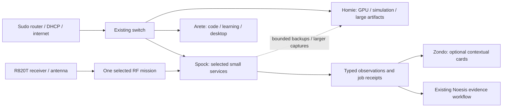

# Spock · Den science and infrastructure node

Status: discovery/research complete; deployment choices await the owner's selection.
22 October 2026. Companion character Zondo remains distinct from the Spock host.

## Verified reality

SSH host fingerprint matches the owner's supplied fingerprint. Spock is Pi 4B
Rev 1.4 with 8 GB RAM, Ubuntu 24.04 arm64, roughly 455 MiB used at the initial
idle sample and 11 GB free on its 16 GB SD. CPU was 52–53°C; get_throttled=0x0
before and after SDR connection: no current or latched throttling flags in this
boot's sampled result. This is not a sustained-load or power-cycle test.

Networkd, resolved and Tailscale are active. Static wired/Wi-Fi addresses and
default metrics match the supplied configuration. The subnet route is advertised;
approval/client routing outside this LAN has not been independently exercised.
Spock's interface is gigabit capable but negotiates 100 Mb/s; its peer advertises
only 10/100. Identify the actual cable/port path before claiming a switch defect.
Local routes to both other Den hosts currently select Wi-Fi, despite the wired
default route having a better metric. Correct local route policy before using
Spock for substantial wired storage/radio traffic, with rollback and both paths.

The existing net-heal script reconfigures both interfaces after two gateway-ping
failures, restarts networkd after four, and reboots after fifteen. This is a poor
fit for an always-on DNS/science node: an upstream outage can interrupt a healthy
local service. No net-heal reboot event was found in the inspected logs, and the
previous boot's ending does not establish why it restarted. Preserve the hardware
watchdog for actual system hangs; redesign network recovery separately.

Firewall is currently inactive. No software stack, firewall or DNS setting was
changed during this discovery. Existing access/configuration is preserved.

### SDR now attached and identified

- USB 0bda:2838 / RTL2838UHIDIR; high-speed 480 Mb/s USB link.
- Kernel explicitly identifies Rafael Micro **R820T** tuner.
- DVB and rtl2832_sdr drivers attached successfully; /dev/swradio0 and DVB nodes
  exist. No USB error was reported in the inspected connection messages.
- Userspace rtl-sdr, rtl_433 and SoapySDR tools are not installed.
- This proves USB/tuner detection, not RF reception, gain calibration, sample
  continuity or antenna suitability. Kernel DVB ownership must be handled cleanly
  for librtlsdr use; never repeatedly fight it with blind USB resets.
- Ordinary R820T hardware should not be assumed to provide HF direct sampling,
  a bias tee, transmission or calibrated RF power measurements.

## Role split

**Arete:** editing, learning, display/UI, portable capture, interactive workflows.
**Homie:** GPU training, simulation, large datasets, archives and heavy services.
**Spock:** always-on DNS, small coordination services, receive-only radio and
  bounded maker/ARM experiments. Its useful work continues when Arete leaves and
  Homie boots Windows. It is not a replacement for either GPU or a NAS on SD.

## Twenty useful roles, ranked rather than all installed

| # | Role / tool | Concrete value | Boundary / first acceptance |
|---|---|---|---|
| 1 | AdGuard Home DNS | Ad/tracker/malware-domain filtering across selected Den clients; per-client controls, local names, temporary pause | Pilot explicit queries first; preserve resolved; verify blocked and allowed domains plus rollback. Domain filtering cannot remove every YouTube/in-app ad. |
| 2 | Tailscale remote LAN gateway | Reach permitted home devices while away, even when Homie is off | Existing route verified locally; test from a genuinely external connection and check access policy/overlapping subnets. Not a second ISP. |
| 3 | OpenWebRX radio room | Actual waterfall, audio, tuning/demodulation in a browser, usable from Den/phone | One authenticated/private receiver profile first; prove FM reception and stable samples. No public receiver by default. |
| 4 | ADS-B aircraft map: readsb + tar1090 | Observe local aircraft, signal coverage and trajectories; practical RF/geometry exercises | Real 1090-MHz reception and suitable antenna required. No fabricated aircraft if nothing received. Sharing feeds is opt-in. |
| 5 | Owned wireless sensors: rtl_433 | Turn compatible thermometers/weather sensors into actual environment data | Choose owned devices/protocols; record units, identity and timestamps. No promise every wireless device is decodable. |
| 6 | Maritime receiver: AIS-catcher | Ship observations connect to underwater-robotics interests | 162-MHz antenna and nearby coverage determine usefulness; test reception before retaining a permanent service. |
| 7 | Satellite experiment bench: SatDump | Schedule a verified active transmitter/pass, record/decode, compare geometry and result | Check current spacecraft status and antenna; old NOAA APT recipes may target retired satellites. Bounded captures only. |
| 8 | RF experiment workbench | Compare antennas, noise floors, USB placement, bandwidth and sample loss | Save receiver config, tuner identity, estimated PPM and environmental context; levels remain relative unless calibrated. |
| 9 | MQTT sensor backbone: Mosquitto | ESP32/robot telemetry and device-state receipts independent of desktops | Authenticated clients and topic ACLs; explicit device/project identities; never an anonymous remote-command bus. |
| 10 | micro-ROS agent / serial gateway | Reusable ESP32/MCU communication and board integration | Explicit ports/permissions, actual board required; flashing and physical actuation stay separately authorized. |
| 11 | ARM64 acceptance node | Test robotics libraries/build outputs on real ARM rather than assuming amd64 works | Short isolated jobs; cap CPU/disk; capture repository revision and result. Heavy builds may belong on Homie. |
| 12 | ROS networking laboratory | Test discovery, QoS, timestamps and constrained links, optional Zenoh/Fast DDS profiles | Ubuntu 24.04 supports Jazzy; existing Humble projects need an explicit compatible environment. No blind live-robot bridging. |
| 13 | Job coordinator and receipts | Submit/check repeatable Homie jobs from a stable node; keep result history when laptop leaves | Reuse Den job contracts, typed launch arguments and explicit host choice. No unrestricted command execution from widgets. |
| 14 | Private notification relay: ntfy | Deliver completed builds, experiment results and chosen reminders to desktop/phone | Auth deny-all by default, limited topics/retention, no large attachments. Zondo consumes verified events, not arbitrary text as commands. |
| 15 | Wake Homie on demand | Start the GPU/storage machine only when needed | First verify NIC/BIOS WoL capability and authorized wake action; magic packets are not proof of successful boot. |
| 16 | FreshRSS research receiver | Collect papers/project releases/lectures while desktops sleep; resume from any device | OPML/export and bounded cache; do not infer learning from a read mark or duplicate Obsidian knowledge. |
| 17 | Private Atuin sync | Search useful shell history across machines, with existing history privacy controls | Check installed client/server version and database support, preserve encryption keys privately; opt-in device enrollment. |
| 18 | Small sync/backup relay | Keep selected configuration/service-state copies available independent of Homie | Do not sync whole vault/media trees onto an 11-GB-free card. Sync is not backup; test an independent restore. |
| 19 | Maker automation: Node-RED / ESPHome / optional Home Assistant | Desk sensors, physical buttons, environmental feedback and deliberate automations | Start with a real device/action. Reuse existing OS; do not reimage into Home Assistant OS or enable physical control implicitly. |
| 20 | Zondo science dispatch / optional Glance view | A living Den: an observed aircraft, newly read source, successful ARM test, a measured antenna improvement | Freshness, provenance, quiet mode and opt-out. No imaginary sensor discoveries, always-on chatter or duplicate bar clutter. |

## Radio ownership: one tuner, coherent use

Choose explicit profiles: Explore/FM, Aircraft, Owned Sensors, Maritime,
Satellite Capture, Experiment. Each profile declares hardware, frequency/rate,
gain, process owner, output and expiry. Stop/confirm the old task before claiming
the USB receiver for another. Multiple decoders can share a compatible sampled
band, but 433 MHz, 1090 MHz and 162 MHz are not simultaneous on this single tuner.

Prefer compressed demodulated audio and waterfall/event streams for normal use.
At 2.4 million samples/s and two 8-bit I/Q components, raw data is about 4.8 MB/s
before protocol overhead: 60 seconds is about 288 MB. Long IQ recordings can fill
this SD quickly and compete with a 100-Mb link. Record only bounded evidence and
move larger artifacts to suitable storage. Keep decoding independent of the UI.

The existing radio widget should select host/profile and embed/open upstream
views, show actual ownership and stale state, and preserve current controls.
No new permanent bar buttons are implied. When Spock has no available receiver,
the widget says so rather than silently using Homie's device or inventing data.

## Ad blocking without breaking the household

Use one DNS stack, preferably AdGuard Home for its client-facing controls and
upstream/DNS-encryption configuration. Pi-hole is a valid alternative, not a
second service competing for port 53. Do not add Unbound solely because a guide
includes it: measure the need and maintain one clear resolver chain.

1. Pin a reviewed ARM64 release and verify its published checksum. Back up
   current network/resolver files privately. Bind deliberately to known service
   addresses; keep administration private/authenticated and preserve OS DNS.
2. Begin with a small maintained filter set. Query it explicitly before changing
   any client's DNS. Test normal sites, local names, game/call endpoints, blocked
   domains, allowlist and timed blocking pause.
3. Pilot one client with an explicit rollback. Test Spock service stop, upstream
   DNS outage, Pi reboot and Ethernet loss separately. Do not equate those faults.
4. Router-wide DHCP DNS needs recovered router-admin access. Without it, only
   configured clients use the filter. Do not take over DHCP to evade this limit.
5. Pick the desired failure policy: strict filtering needs an independent filtered
   resolver; a public fallback preserves connectivity but can bypass blocking
   even while Spock is healthy. Two IPs on Spock are one failure domain. AdGuard's
   upstream fallback only handles upstream failure, not dead SD/power/service.
6. Browser content blocking complements DNS for same-domain ads. No claim of
   universal ad removal or advertising-system rate-limit bypass.

## First rollout choices

Recommended combination: **1 + 3 + 5 + 14**, retaining existing role 2; add 4 or
6 after an antenna/reception test. These provide ad filtering, interactive radio,
real sensor/maker value and useful character/phone events, without a heavy stack.

Optional research choice: 16 + 11 for reading and real ARM validation.
Optional physical choice: 9 + 10 + 19 when boards/sensors are available.

### P0: foundation before critical services

- Back up Spock's configuration off-device and prove restoration to a disposable
  directory. Do not copy private netplan credentials into public dotfiles.
- Correct local route preference with netplan/networkd validation and a timed
  rollback; preserve both paths and existing SSH host identity.
- Replace gateway-ping-triggered reboot/network restarts with evidence-based,
  bounded recovery. Test bad gateway responses in a fixture, not on live LAN.
- Confirm the static addresses are outside the router pool or reserved before
  relying on them as household DNS. Router admin remains unavailable.
- Preserve legal country settings; investigate firmware rejection against the
  installed firmware/package versions, not by choosing a false country code.
- Set explicit journald/service retention and SD free-space floor. Proposed
  operational floor: 4 GB free, to be tested rather than called a measured need.
- Investigate reboot cause further; no current undervoltage is not proof of no
  past power interruption. No automatic reboot tests during active use.

Done when: wired local routing verified, remote access survives a controlled
single-path test, backups restore, no gateway outage causes a blind reboot.

### P1: DNS pilot

Use spock/ subdirectory for reusable units/config templates, per-node private
secrets and explicit installer/rollback. Test allow/block/override, upstream
failure and stop/restore with an individual client. Done when the actual client
uses it and the documented failure policy is demonstrated. No household DNS
change before router access and rollout decision.

### P2: radio vertical slice

Install reviewed receiver packages, handle DVB driver claim once and reversibly,
add precise udev access and one receiver service. No blanket root device access.
First test rtl_test/sample continuity, FM audio and browser waterfall, then the
chosen specialised profile. Record antenna/frequency/gain and real observations.
Done when switching profiles releases hardware correctly and Arete/Homie can
use the receiver privately. Remove any profile that has no demonstrated value.

### P3: Den and Zondo integration

Reuse Action Registry and existing radio/engineering panels. Expose typed status,
profile-select/start/stop/open and evidence-capture actions with backend argument
validation. Add verified event receipts with freshness and quiet-mode policy.
Keep Zondo's small talk separate from measurements. Do not let arbitrary MQTT or
web text become a shell command. Done when a real RF observation or ARM job
produces one useful card and a retrievable record without blocking main work.

### P4: optional missions

Add only selected roles from the table; measure idle RAM, CPU, SD growth and task
latency before/after each. Dependencies such as an MQTT sensor or AIS antenna
must exist before declaring a feature working. Heavy services stay on Homie.

## Deliberately not installed now

The owner requested findings and a decision first. No AdGuard/Pi-hole, container
runtime, SDR userspace stack or additional dashboard was installed; no tuner was
unbound or sample recording started. No firewall, DHCP, network, DNS or Tailscale
policy was changed. No broker, packet capture or radio feed was exposed publicly.

Do not put Immich/Jellyfin transcoding, full Wikipedia downloads, Kubernetes,
large model inference, long IQ recordings or GPU training on this SD-only Pi.
They would consume resources without fitting its role. Revisit storage-heavy
roles after an actual SSD and power/backup plan, not before.

Research source matrix and exact 120-query ledger: SPOCK-RESEARCH.md.
