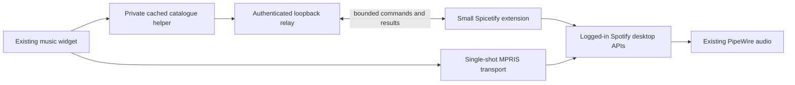

# Spotify widget: desktop-session backend · 2026-10-16

## Fault and change

The earlier official-backend switch replaced **transport only**. Browsing still
used the shared ncspot developer application, whose Web API quota was exhausted.
Consequently functioning Play/Pause was never evidence of a functioning library.

The official selection now uses the authenticated desktop client for playlists,
liked songs, albums, artists, search, context tracks, queue and devices. Basic
transport uses MPRIS; richer selections use the client's native PlayerAPI. No
Spotify access token, cookie, keyring or account database is exported. No new
Spotify developer account is required for this backend.



The relay binds only 127.0.0.1, checks Host and a random per-machine secret, allows
specific operations, rejects arbitrary evaluation, and does not follow redirects.
Its Python implementation uses the standard library. A single long poll keeps the
extension idle between requests. Sample service memory was approximately 12 MiB;
this is additional relay memory, not the Spotify desktop application's memory.

Read data is cached privately. Failed refreshes preserve saved rows. Writes are
not retried, and successful writes expire caches without deleting saved data.
Ambiguous timeouts stay errors rather than replaying playlist edits or skips.

## Setup and recovery

With spotify-launcher and Spicetify CLI installed and Spotify signed in:

```sh
python3 scripts/install.py --hardware zenbook --apply # pc on Homie
sensei-spotify-bridge-setup                         # preview
sensei-spotify-bridge-setup --apply                 # configure and start
```

Daily use remains in the widget. Account → **Repair desktop bridge** invokes the
same maintained setup. Existing theme settings/extensions are preserved. The
setup saves the old application assets and configuration privately before edits.
It may close/reopen only Spotify when applying a changed extension. A hung Quit
gets SIGTERM only for this user's exact configured Spotify executable; no input,
terminal or unrelated application is stopped. Repair does not automatically start
music or transfer a device.

The user service starts at the graphical session. Spotify must be open (it can be
minimized) for fresh catalogue data. Account reports desktop bridge/session state,
instead of presenting the unused native daemon as the current backend.

Private state: `~/.config/sensei-den/spotify-bridge.json`, rendered extension under
Spicetify's Extensions folder, `~/.cache/sensei-spotify/desktop/`, and recoverable
assets under `~/.local/state/sensei-den/music-repair/`. Never publish these files.
Templates in the dotfiles contain placeholders, not the local secret.

For rollback, stop the bridge and restore the corresponding saved Apps tree and
Spicetify configuration, with Spotify closed. Preserve the Spotify account/prefs
and keyring. `backend native` remains available, but does not cure its exhausted
Web API quota. Do not clear the budget to pretend the provider limit disappeared.

## Boundaries

- This is an integration with **internal** client APIs, not a supported Spotify
  public API. Upgrades can break it. The client/Spicetify versions and live checks
  below are the compatibility evidence; they are not a future guarantee.
- The widget launcher preserves the installed client with `--skip-update` once
  the bridge is configured. Explicit Spotify upgrades need a compatible
  Spicetify rebuild/repair; do not silently replace this tested pairing.
- Spicetify 2.45.3's published Linux support range ends at 1.2.96. This machine's
  1.3.4 client was tested directly; do not claim upstream certifies that pairing.
- Desktop-library browsing does not consume the exhausted developer Web API path.
  Spotify's own service can still refuse/rate-limit a request; no unlimited access
  claim is made. No DRM, authentication, advertising or subscription patch is added.
- “Top tracks” means frequency in available recent desktop history, clearly
  labelled; it is not a fabricated all-time or long-term Spotify statistic.
- A client returning total=0 with a full liked-song page does not end pagination.
  Continue until a short page or a valid reported total. No fake total is shown.
- MPRIS HTTP track URLs are normalized to Spotify URIs for identity matching.
  Native playlist membership/order is retained; repeated songs aren't deduplicated.
- Downloaded CLI release 2.45.3 matched GitHub's published asset SHA256
  `29e7f0fb49c4a722afbd7e305c25d3953b4cf0cb642216bfd4de69f63bb2c41e`.
  GitHub attestation lookup returned 404; provenance verification was **not** claimed.

## Live acceptance

On both Arete and Homie, the actual widget loaded 52 playlists; liked songs expanded from 100 to
200 through its Load more action. Selecting a liked row and a playlist's third
row played their exact canonical track identities. Playlist contents returned 50
tracks, search returned 26 tracks in the inspected query, and the queue contained
47 upcoming rows after the selection. Albums and artists returned distinct kinds;
album/artist context browsing returned songs. Screenshots were inspected privately,
not committed with the user's personal playlist names.

The full suite passed 287 tests; 29 focused Spotify tests passed. The owned live
workflow is reproducible with `python3 scripts/check-spotify-desktop.py --live`
when changing playback is acceptable (reference account requires 200 liked songs).
Setup preview reports no changes after application on each host. Setup now waits
for a real desktop bridge handshake before announcing readiness. An initial
immediate post-launch PC check encountered cached rows before the extension was
connected; the readiness gate fixes that test/startup race. The repeated connected
workflow passed. The bridge
service is enabled for subsequent graphical sessions.

Automated tests cover relay authentication/Host checks, operation allowlisting,
connection loss, saved-data retention, typed pagination, zero-total pages,
nested folders and search-wrapper normalization. An explicit laptop-local Connect selection also succeeded. Homie subsequently
controlled the songs while the laptop remained the active device (PC local
active=false, external active=true). The laptop Spotify stream was unmuted and
produced nonzero PCM: 98,304 float samples, RMS 0.00797. PCM was not saved.
A closed desktop now reports an explicit reconnect state, with a player-change
refresh, instead of retaining a false Playing indicator. Library-write and
phone-handoff acceptance remain distinct from successful read/playback tests.

## Research ledger

Twelve targeted searches were executed, in four groups of three. Search count is
coverage, not evidence quality. Primary documentation/source inspection drove the
implementation; practitioner reports served as leads only.

| Query | Evidence / decision |
| --- | --- |
| spotify player QUOTA_EXCEEDED 2026 shared client id library alternatives | [Spotify quota update](https://developer.spotify.com/blog/2026-07-23-web-api-quota-updates): per-developer quota; do not repeatedly reset/retry it. |
| Spicetify CosmosAsync get user playlists library API | [CosmosAsync](https://spicetify.app/docs/development/api-wrapper/methods/cosmos-async): existing client integration; prefer typed native services where available. |
| Spotify desktop remote debugging port CDP spicetify local API | [Client flags](https://spicetify.app/docs/development/spotify-cli-flags): avoid exposing a general remote-debugging endpoint. |
| Spotify developer web API quota exceeded July 2026 official | Provider quota documentation above confirms backend distinction. |
| spotify-player custom client id rate limits official documentation | [spotify-player](https://github.com/aome510/spotify-player): changing another Web API wrapper does not itself remove provider quotas. |
| Spicetify CLI Spotify Linux launcher installation | [Getting started](https://spicetify.app/docs/getting-started): use the actual launcher install path and preserve backups. |
| Spotify desktop MPRIS playlists TrackList supported | Actual installed MPRIS interface exposes transport, not the necessary library. Keep transport and catalogue boundaries separate. |
| librespot mercury library playlists API deprecated | [librespot source](https://github.com/librespot-org/librespot): another audio engine is not a library-management replacement. |
| ncspot library playlists uses web api quota | [ncspot source](https://github.com/hrkfdn/ncspot): same provider constraint; avoid another shared application identity. |
| Spicetify Web API token rate limit internal spclient | [Platform documentation](https://spicetify.app/docs/development/api-wrapper/methods/platform): internal APIs vary; inspect installed methods, do not export tokens. |
| spotify local API desktop library bridge spicetify extension | [Wrapper documentation](https://spicetify.app/docs/development/api-wrapper): reuse existing API exposure with a small explicit bridge. |
| Spotify web playback SDK library API rate limit alternatives | [Web Playback SDK](https://developer.spotify.com/documentation/web-playback-sdk): playback is not full library browsing; adding another renderer would not solve the requirement. |

Additional inspection: [Spicetify 2.45.3 release](https://github.com/spicetify/cli/releases/tag/v2.45.3),
[PlayerAPI](https://spicetify.app/docs/development/api-wrapper/methods/player),
version-matched type definitions and installed client method signatures. The
installed read APIs and live widget behavior were verified before choosing them.
